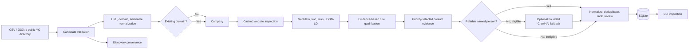

# GEO Research Outreach Agent

A small, standalone Python application for discovering and qualifying potential partners for Generative Engine Optimization (GEO) research. It is deliberately separate from the existing GEO audit/experiment platform: it neither imports that platform nor integrates with it.

## MVP scope

Phase 1 imports safe local CSV/JSON demo data. Phase 2A adds bounded YC discovery and website evidence. Phase 2B adds a public local-chamber source, separates eligibility/opportunity/priority/confidence, and provides ranking plus independent human review. Phase 3 and 3B add first-party contact extraction with an optional selective Crawl4AI fallback. Phase 3C ranks official business channels, including published business emails and contact forms, for mandatory human review. Phase 5A adds provider-free draft generation and a local-only simulated workflow; it does not add real message delivery or form submission.



SQLite is the internal source of truth. Google Sheets may later become a human-facing operational interface, but is intentionally absent now.

## Architecture decisions

- `Company` owns research suitability state: `DISCOVERED`, `QUALIFIED`, `NEEDS_REVIEW`, `REJECTED`, or eventually `READY_FOR_GEO`.
- Company lifecycle changes use an explicit allowed-transition map; terminal handoff cannot silently move backward.
- `Outreach` has a separate lifecycle (`DRAFT` through `SENT`/`FAILED`/`CANCELLED`). A qualified company is not the same thing as a sent message.
- One company is identified primarily by a normalized domain. Multiple `DiscoveryRecord` rows retain distinct source identifiers without duplicating the company.
- A repeated import is idempotent for both companies and identical provenance. Database uniqueness constraints backstop application checks.
- Qualification is explainable and configured in `config/qualification.yaml`; these are provisional research heuristics, not scientific conclusions.
- Eligibility, GEO opportunity, outreach priority, and evidence confidence are distinct machine outputs. Missing evidence becomes `UNKNOWN`/`NEEDS_REVIEW`, never an assumed negative opportunity.
- Priority tiers use absolute YAML thresholds, never percentiles or forced distributions.
- Human review (`PENDING`, `APPROVED`, `REJECTED`, `MAYBE`) is independent and survives requalification.
- Raw industry labels are preserved alongside a deliberately small normalized taxonomy. Exact employee counts are stored only when a source reports them; otherwise size is `UNKNOWN`.
- Website evidence is stored separately as one `WebsiteSnapshot` with a few `WebsitePage` rows. Company rows remain compact.
- Public collection is sequential, identifies itself with a research User-Agent, checks robots rules, caps pages and response size, and records blocks/failures instead of bypassing them.
- Fresh snapshots are reused for the configured TTL (168 hours by default); `--refresh` is an explicit opt-in.
- Contact enrichment defaults to `HIGH` and `MEDIUM` priority companies and reads stored first-party website evidence. It records explicit contactability and channel outcomes rather than guessing.
- A person is created only when first-party evidence explicitly associates a plausible name with a relevant role; an email is optional. Generic published mailboxes remain separate `GENERIC_BUSINESS_CONTACT` records, and no address is generated from a name or domain.
- The same `enrich-contacts` run extracts business channels from the fetched HTML: partnership, business-development, general-business, named-person, sales/marketing, support, restricted email, and official contact form. It recommends one suitable primary channel and preserves alternatives. Unsuitable support/restricted channels remain visible for review but are never recommended.
- Role ranking is contextual: founder/owner leads for startups, marketing/digital/content leads for medium companies, and owner/general management leads for local SMBs.
- Phase 5A has no real sending adapter. The offline `DemoTransport` has no network code path; the real-delivery gate stays blocked even when every future approval/configuration flag is true.

## Setup

Requires Python 3.12 or newer.

```bash
python3.12 -m venv .venv
source .venv/bin/activate
python -m pip install '.[dev]'
```

Configuration lives in `config/`. Environment variables may override `OUTREACH_DATABASE_URL`, `OUTREACH_LOG_LEVEL`, and `SEND_MODE`; copy `.env.example` as a reference, but note that `.env` loading is not automatic and secrets must not be committed.

## CLI and demo

The default database is `data/outreach.db`.

```bash
python -m outreach_agent init-db
python -m outreach_agent discover --source data/demo_companies.csv
python -m outreach_agent discover --source data/demo_companies.json
python -m outreach_agent discover-real --limit 25
python -m outreach_agent discover-chamber --limit 40
python -m outreach_agent inspect-websites --limit 25
python -m outreach_agent website-evidence 1
python -m outreach_agent qualify
python -m outreach_agent qualify --requalify
python -m outreach_agent enrich-contacts --priority HIGH,MEDIUM --limit 25
python -m outreach_agent enrich-contacts --priority HIGH,MEDIUM --review APPROVED,MAYBE --limit 25
python -m outreach_agent contacts list --review PENDING
python -m outreach_agent contacts show 1
python -m outreach_agent contacts review-set 1 APPROVED --notes "Verified on first-party team page"
python -m outreach_agent candidates rank --limit 20 --review PENDING
python -m outreach_agent review set 1 MAYBE --notes "Professor review needed"
python -m outreach_agent calibration-report
python -m outreach_agent export-review --output data/research_partner_review.csv
python -m outreach_agent import-review --source data/research_partner_review.csv
python -m outreach_agent export-company-selection --output data/company_selection_review.csv --summary data/company_selection_summary.csv
python -m outreach_agent review override-channel 1 12 --reason "Official partnership page is the best fit"
python -m outreach_agent companies list
python -m outreach_agent companies show 1
python -m outreach_agent status
```

Run discovery again to confirm idempotency: no new company or identical provenance rows will be created. Use `qualify --force` only when deliberately re-evaluating records after changing rules.

`discover-real` defaults to the official, public static YC Consumer industry directory and accepts another static category URL with `--directory-url`. It ignores inactive companies and companies reporting more than 250 people, caps a run at 50, and retains the YC company ID/profile URL and directory route as provenance. Static routes are checked against `robots.txt` fail-closed; the disallowed query-driven directory route is not used.

`discover-chamber` reads public listing cards from the Greater Dalton Chamber GrowthZone directory. This source was selected to add local services, retailers, healthcare, finance, manufacturing, and nonprofit organizations rather than another internet-startup-only population. It reads business names, public websites, locations, and categories; it does not open email/contact endpoints. Its current robots policy permits the alphabetical listing routes.

## Phase 6D candidate pool (separate from campaigns)

Phase 6D keeps newly acquired candidates in `data/phase6d_candidates.db`; the 537-company active cohort, frozen 77-company database, and campaign sidecar are not imported into or rewritten by this layer. Candidate records begin as `DISCOVERED_UNVERIFIED`, `UNKNOWN` GEO eligibility, `NOT_DISCOVERED` contact status, pending human review, and `NOT_READY` for outreach. They cannot be selected into campaigns. The bulk source is the official Geofabrik OpenStreetMap US Northeast extract, licensed under ODbL 1.0. Attribution to OpenStreetMap contributors is retained in rows and exports. If distributing the derived database publicly, comply with ODbL share-alike requirements; internal-use details and attribution guidance are in the Phase 6D report.

### Phase 6E candidate screening and verification

Phase 6E screens the complete 57,664-domain pool: all 57,127 OSM leads receive a structured-data screen, while the existing 537-company cohort is projected from saved qualification and identity evidence without changing its source database or review decisions. Screening and bounded website verification are stored in the independent `data/phase6e_candidates.db` working copy. The Phase 6D source database remains read-only input. Reproduce the source/category/domain audit and exports with `PYTHONPATH=src uv run python scripts/phase6e_screen.py audit`, `screen`, and `export`. Create the deterministic 140-record, seven-group OSM calibration sample with `sample --per-category 20`; record the documented offline desk-review labels with `review-sample`. The offline screen is a lead-priority heuristic, not proof of operation, identity, SMB status, or eligibility. `priority_basis` distinguishes the existing cohort’s saved score from the Phase 6E screening heuristic; the numeric scores are not directly comparable.

For bounded live verification, run `PYTHONPATH=src uv run python scripts/phase6e_screen.py verify --budget 20 --request-budget 100`. `--budget` caps company sites and `--request-budget` is a hard HTTP-attempt cap including redirects and retries. The existing crawler honors `robots.txt`, uses a 12-second timeout, one retry, a two-page-per-site limit, and a one-second inter-request delay. Re-running resumes only still-unverified rows; completed outcomes are retained. Only identity-verified sites are automatically qualified; ambiguous/blocked/failed sites remain `NEEDS_REVIEW`/`UNKNOWN`. Contact discovery remains a separate task.

Outputs are `data/phase6e_top_5000_candidates.csv`, `phase6e_verified_candidates.csv`, `phase6e_geo_eligible_candidates.csv`, `phase6e_contact_discovery_priority.csv`, `phase6e_exclusion_uncertainty_report.csv`, and `phase6e_website_verification.csv`. Top-5,000 rows remain explicitly marked by screening and identity status; the filename does not imply verification. The dashboard’s Companies page includes source/screen/identity filters and these exports. New OSM leads do not enter campaign selections. Full audit and measured pilot results are in [`docs/phase6e_candidate_quality.md`](docs/phase6e_candidate_quality.md).

### Phase 6F bounded verification and contact evidence pilot

Phase 6F selects 500 still-unverified OSM candidates from the Phase 6E Top 5,000 using likely-fit category, independence/domain flags, descending Phase 6E priority, and stable domain tie-breaking. Previously verified and previously attempted records are excluded. It creates the separate `data/phase6f_candidates.db` backup once and resumes selected pending records without changing Phase 6E or source databases. Run/resume the pilot with `PYTHONPATH=src uv run python scripts/phase6f_pilot.py run --limit 500 --batch-size 20 --request-cap 3000 --time-cap-seconds 10800 --cost-cap-usd 0`; request and time caps are cumulative across invocations. Paid-service cost is hard-capped at $0.00; no paid API or LLM is used. `status` reports progress and database integrity; `export` regenerates stable CSVs. The WebsiteCollector respects robots/access restrictions and does not bypass blocks. Existing identity and qualification logic is reused. Contact evidence is limited to explicit public same-domain channels on verified GEO-eligible companies, remains pending human review, and is never submitted or outreach-approved.

Outputs include `data/phase6f_selected_500.csv`, `data/phase6f_verified_companies.csv`, `data/phase6f_geo_eligible_companies.csv`, `data/phase6f_contact_candidates.csv`, `data/phase6f_validation_failures.csv`, and `data/phase6f_pilot_report.md`. The Companies candidate panel shows processed, verified, GEO-eligible, contact, pending, and review-required counts when the Phase 6F database exists.

### Phase 6G contact quality audit and review

Run `PYTHONPATH=src uv run python scripts/phase6g_audit.py audit` to classify and deduplicate saved Phase 6F channels offline and generate `data/phase6g_contact_quality_audit.csv`, `data/phase6g_contact_review_queue.csv`, `data/phase6g_verification_failure_analysis.csv`, and `data/phase6g_optimization_report.md`. The raw Phase 6F channel evidence is not modified. The Companies page includes a paginated human review queue with evidence/provenance, source/confidence/review filters, per-channel approve/reject, company further-review marking, and filtered export. Those decisions live in `data/phase6g_contact_review.db` and cannot authorize research participation, campaign inclusion, or sending.

One bounded comparison sample of 15 transient fetch failures (DNS/TLS/timeout/connection) and 15 ambiguous identities can be run/resumed with `PYTHONPATH=src uv run python scripts/phase6g_audit.py evaluate --batch-size 10 --request-cap 90 --time-cap-seconds 600`. It uses the existing verifier and qualification rules in the isolated `data/phase6g_evaluation.db`; blocked and robots-denied sites are excluded. Rerun `... phase6g_audit.py report` (or `audit`) to refresh the report/exports. No network call is made by audit/export/report. All channels remain pending until reviewed, and no outreach or forms are sent/submitted.

### Phase 6H remaining-shortlist verification and contact discovery

Before requesting any websites, reconcile the frozen Phase 6E Top 5,000 against Phase 6E outcomes and the Phase 6F selection:

```bash
PYTHONPATH=src uv run python scripts/phase6h_scale.py preflight
PYTHONPATH=src uv run python scripts/phase6h_scale.py prepare
```

Phase 6H creates `data/phase6h_candidates.db` as a one-time SQLite backup of Phase 6F and persists the exact never-attempted candidate IDs in a stable worklist. Phase 6E and Phase 6F databases remain read-only. Run or resume 250-candidate selected batches with request/time caps (caps are cumulative across saved runs):

```bash
PYTHONPATH=src uv run python scripts/phase6h_scale.py run --batch-size 250 --request-cap 3000 --time-cap-seconds 7200 --chunk-request-budget 500
PYTHONPATH=src uv run python scripts/phase6h_scale.py status
PYTHONPATH=src uv run python scripts/phase6h_scale.py export
```

The website collector uses bounded retries, timeout and request budgets, serial per-domain processing, robots/access checks, and the existing identity/qualification rules. It does not bypass bot protection, submit forms, send email, or create approvals. If a cap interrupts a batch, completed candidate checkpoints are reused and only records still marked `DISCOVERED_UNVERIFIED` are retried. Each full configured batch is checked against a documented 50%-of-Phase-6F verification/eligibility yield floor; a low-yield batch pauses for inspection. The existing Companies page shows overall Top-5,000 processed/verified/GEO/contact-review metrics, and its Phase 6G review queue reads Phase 6H evidence while preserving the existing `data/phase6g_contact_review.db` decisions.

Phase 6H writes `data/phase6h_verified_companies.csv`, `phase6h_geo_eligible_companies.csv`, `phase6h_business_email_contacts.csv`, `phase6h_official_contact_forms.csv`, `phase6h_contact_review_queue.csv`, `phase6h_execution_metrics.csv`, and `phase6h_final_report.md`. The company/contact exports cover the full Top 5,000 snapshot; the execution metrics cover Phase 6H runs. Verification is not human review, and discovered channels remain pending until reviewed.

### Phase 7 full-pool contactable-company qualification

Phase 7 audits the 57,664-domain candidate pool (including, not in addition to, the 537-company cohort), recovers already-saved first-party contact evidence offline, then processes the complete never-attempted pool in resumable quality-first batches. A company counts only with verified identity, successful substantive first-party website evidence, existing GEO `ELIGIBLE` status, and a suitable same-domain public business email or a confirmed form with visible controls. Contact pages alone, unresolved chain/repeated-name candidates, inappropriate role inboxes, and pending/failed/blocked sites do not count. Contact review is not send approval; Phase 7 does not send or submit anything.

```bash
PYTHONPATH=src uv run python scripts/phase7_contacts.py preflight
PYTHONPATH=src uv run python scripts/phase7_contacts.py prepare
PYTHONPATH=src uv run python scripts/phase7_contacts.py run --batch-size 500 --request-cap 250000 --time-cap-seconds 172800 --chunk-request-budget 500 --concurrency 4 --export-each-batch
PYTHONPATH=src uv run python scripts/phase7_contacts.py status
PYTHONPATH=src uv run python scripts/phase7_contacts.py export
```

For a persistent overnight run on macOS, use the per-user LaunchAgent instead of leaving a terminal command open. Installation starts the worker; status, graceful stop, start, and cap-increasing resume are available as commands:

```sh
PYTHONPATH=src uv run python scripts/phase7_service.py install
PYTHONPATH=src uv run python scripts/phase7_service.py status
PYTHONPATH=src uv run python scripts/phase7_service.py stop
PYTHONPATH=src uv run python scripts/phase7_service.py start
PYTHONPATH=src uv run python scripts/phase7_service.py resume
```

The LaunchAgent runs at concurrency 4, holds the Mac awake only while active with `caffeinate`, checkpoints every internal chunk, and refreshes the full-pool exports after each completed 500-candidate batch. Initial cumulative hard caps are 250,000 HTTP attempts and 48 hours; a cap stop is visible in `status`, and `resume` raises both finite caps. It resumes at login after a restart, not before login. Read [the Phase 7 overnight worker guide](docs/phase7_overnight_worker.md) for exact behavior, safety limits, exports, and logs.

Caps are cumulative across runs. Increase them to resume; checkpointed results are reused. `--concurrency 4` allows four distinct company inspections while preserving sequential requests within each domain. A database-level lock prevents overlapping runners. Use `--max-candidates 200` for a bounded benchmark. Outputs are `data/phase7_contactable_companies.csv`, `phase7_contact_channel_audit.csv`, `phase7_validation_failures.csv`, `phase7_exclusion_queue.csv`, `phase7_yield_metrics.csv`, and `phase7_final_report.md`. See [`docs/phase7_contactable_company_database.md`](docs/phase7_contactable_company_database.md) for strict count semantics and [`docs/phase7_performance_optimization.md`](docs/phase7_performance_optimization.md) for measured performance and the benchmark. The strict contactable export is an all-industry count; it is not itself the SMB/SME target count.

#### Offline SMB/SME target reconciliation

The professor's 5,000-company target means small and medium-sized businesses. It does not require YC affiliation, venture funding, recent founding, accelerator participation, or technology-sector classification. Unknown size remains `SIZE_UNKNOWN` and requires evidence or review. Hotels are tracked in the separate 3,000-property target and excluded from the SMB count. Reconcile the complete saved Phase 7 pool without crawling:

```bash
PYTHONPATH=src uv run python scripts/phase7_smb_reconcile.py
```

The reconciliation reads the Phase 7 database, preserved Phase 6A size evidence, current hotel properties, and existing strict contact/evidence exports in read-only mode. It creates `data/phase7_smb_reconciliation.csv` (full pool), `data/phase7_smb_contactable_companies.csv`, `data/phase7_smb_size_review_queue.csv`, `data/phase7_cohort_domain_overlap.csv`, and a summary JSON. The overlap CSV lists exact-domain matches for identity review only; a shared chain website is not proof that a hotel property and a company record are the same company. The Overview dashboard displays SMB counts, unknown-size workload, channel breakdown, hotel exclusions, and potential overlaps; the exports are available from the dashboard. Current measured counts and policy are in [`docs/phase7_smb_target_reconciliation.md`](docs/phase7_smb_target_reconciliation.md). No approvals or outreach permissions are created.

### Separate hotel-property research pipeline

Hotels are stored by OSM property ID rather than canonical domain, so two locations that share a chain website remain distinct properties. OSM tags are candidate evidence only. The isolated hotel database reuses the existing first-party website identity verifier, GEO qualification rules, bounded crawler, and contact extractor; no property counts as verified until those checks pass. The existing US Northeast PBF is ODbL-licensed, with OpenStreetMap attribution and source element URLs retained. Guest segments are not inferred, and room/amenity fields are explicitly retained as unverified OSM source tags until corroborated.

```bash
PYTHONPATH=src uv run python scripts/phase7_hotels.py discover
PYTHONPATH=src uv run python scripts/phase7_hotels.py status
PYTHONPATH=src uv run python scripts/phase7_hotels.py cohort-export
PYTHONPATH=src uv run python scripts/phase7_hotels.py pilot --limit 25 --request-budget 100
PYTHONPATH=src uv run python scripts/phase7_hotels.py export
PYTHONPATH=src uv run python scripts/phase7_hotels.py install --request-cap 1000 --time-cap-seconds 21600
PYTHONPATH=src uv run python scripts/phase7_hotels.py stop
```

The hotel LaunchAgent is separate from the Phase 7 company worker, uses one concurrent company inspection and 25-property checkpoints, and has a database-level lock, explicit cumulative request/time caps, logs under `logs/hotel_worker*.log`, and a stop-after-current-batch request. It never submits a form or sends a message. The current regional extract is a candidate source, not enough by itself to claim 3,000 verified hotels; other properly licensed regions or structured sources must be added if pilot yield confirms the need.

Hotel properties are classified as both `BUSINESS` and `HOTEL` candidates in hotel exports, with property-level IDs and a separate hotel-cohort membership. `cohort-export` writes `data/phase7_hotel_cohort_membership.csv` without touching the worker or its database. They are excluded from the SMB target by default; unknown or chain ownership never implies SMB size. Exact-domain matches between property and company pools are emitted as unconfirmed review leads, not merged identities. Existing hotel-tagged records in the general-business pool remain there, avoiding data loss and automatic double-counting.

Company-level channel coverage on the dashboard distinguishes email-only, form-only, both, no channel, and evidence needing review. Campaign creation keeps form-only records in a separate manual review queue. Export that queue from Campaigns or use `/api/campaigns/form-review-queue.csv`; the CSV includes the official form URL, prepared message, evidence URL, and explicit `NOT_SUBMITTED` state. It does not change contact approvals or send status.

The historical YC-only progress snapshot is retained in [`docs/phase7_new_targets_initial_progress.md`](docs/phase7_new_targets_initial_progress.md); it is superseded for target counts by the [SMB/SME reconciliation](docs/phase7_smb_target_reconciliation.md). The reusable company report template is [`templates/company_geo_analysis_report_template.docx`](templates/company_geo_analysis_report_template.docx).

### Separate hotel-property research pipeline

Hotel properties are stored separately from the SMB/company candidate database. The initial bounded pilot uses a deterministic, domain-diverse sample; OSM records are property candidates and do not establish current operation or independent ownership. Geofabrik extracts carry OpenStreetMap ODbL attribution requirements. Download regional `.osm.pbf` files only from permitted official Geofabrik pages, then import and resume with:

```bash
uv sync --extra openstreetmap
PYTHONPATH=src uv run python scripts/phase7_hotels.py discover --pbf data/raw_sources/us-northeast-261014.osm.pbf data/raw_sources/hotel_states/california-latest.osm.pbf data/raw_sources/hotel_states/texas-latest.osm.pbf data/raw_sources/hotel_states/georgia-latest.osm.pbf
PYTHONPATH=src uv run python scripts/phase7_hotels.py pilot --limit 25 --request-budget 100
PYTHONPATH=src uv run python scripts/phase7_hotels.py install --request-cap 20000 --time-cap-seconds 86400 --batch-size 25
PYTHONPATH=src uv run python scripts/phase7_hotels.py status
PYTHONPATH=src uv run python scripts/phase7_hotels.py stop
PYTHONPATH=src uv run python scripts/phase7_hotels.py resume --request-increment 20000 --time-increment-seconds 86400
PYTHONPATH=src uv run python scripts/phase7_hotels.py export
PYTHONPATH=src uv run python scripts/phase7_hotels.py profiles
```

The independent hotel worker uses a separate database lock, one active HTTP inspection at a time, finite cumulative caps, 25-property checkpoints, and the shared robots/identity/GEO/contact verification pipeline. It pauses after a full batch if access blocks reach 40%, a material increase from the measured 20% pilot baseline. Stop requests are honored between batches. Contact channels stay pending review; no messages or forms are submitted. The `profiles` command exports verified, GEO-eligible hotel properties and a legacy verified, GEO-eligible YC-attributed company subset to separate versioned JSONL handoffs documented in [`docs/phase7_geo_platform_integration.md`](docs/phase7_geo_platform_integration.md). The YC subset is not the 5,000-SMB target. The command does not write to the separate GEO platform.

See [`docs/phase7_hotel_pilot_report.md`](docs/phase7_hotel_pilot_report.md) for acquired-source counts, pilot metrics, worker caps and resume instructions, and [`docs/phase7_new_targets_current_status.md`](docs/phase7_new_targets_current_status.md) for the current SMB/SME reconciliation and separate hotel target status.

To acquire the dated extract, install the optional parser and run the reproducible import. The PBF is intentionally ignored by Git and should remain in `data/raw_sources/`:

```bash
mkdir -p data/raw_sources
curl -L --fail --retry 2 https://download.geofabrik.de/north-america/us-northeast-261014.osm.pbf -o data/raw_sources/us-northeast-261014.osm.pbf
uv sync --extra dev --extra openstreetmap --extra gmail
PYTHONPATH=src uv run python scripts/phase6d_candidates.py acquire-import
PYTHONPATH=src uv run python scripts/phase6d_candidates.py status
```

The import filters named commercial OSM objects for HTTP(S) websites, excludes common profile/directory hosts and explicit inactive tags, and deduplicates on the existing canonical-domain normalizer against all 537 active domains. Each OSM element is retained in `candidate_provenance`; every candidate is still an unverified lead until first-party identity evidence is inspected. The script reports actual source yield and writes threshold checkpoints only when the real combined total reaches them.

Website identity and existing GEO qualification can be run in resumable, sequential batches of up to 100 (25 is the safe default). This makes bounded homepage and one additional page inspections, respects robots rules, and never stores contact evidence or changes human review:

```bash
PYTHONPATH=src uv run python scripts/phase6d_candidates.py verify-batch --limit 25
PYTHONPATH=src uv run python scripts/phase6d_candidates.py export
```

The exports `data/all_candidates.csv`, `data/verified_companies.csv`, `data/geo_eligible_companies.csv`, and `data/contact_candidates.csv` contain the preserved active cohort plus the isolated candidate layer, with source, permission note, and status columns. The read-only Companies page shows the new pool separately from campaign selection. Contact discovery and outreach are not run as part of candidate acquisition.

`inspect-websites` checks `/robots.txt` before crawling, probes `/sitemap.xml` conservatively, fetches the homepage, and follows at most the configured number of high-value same-domain links. It never recursively crawls a site. Use `--refresh` to deliberately replace fresh cache use with a new snapshot.

Collection settings in `config/settings.yaml` control timeout, one-second request delay, retry count, page/company caps, response-size cap, User-Agent, and cache TTL.

## Contact discovery and review

Run `inspect-websites` before `enrich-contacts`. Website inspection follows only a bounded set of same-domain high-value links, including contact, about, team, leadership, and staff pages, while honoring robots rules and caching. Contact enrichment then consumes the stored structured evidence; it does not require LinkedIn, logins, CAPTCHA bypasses, paid enrichment APIs, personal social profiles, leaked data, SMTP probing, or mailbox guessing.

Contacts use a compact role taxonomy: `FOUNDER_OWNER`, `EXECUTIVE`, `MARKETING_GROWTH`, `SEO_CONTENT`, `PARTNERSHIPS`, `BUSINESS_DEVELOPMENT`, `DIGITAL_ECOMMERCE`, `COMMUNICATIONS`, `GENERAL_BUSINESS`, `OTHER`, and `UNKNOWN`. Ranking reasons identify the company context and whether an explicit public email exists. Syntax validation means only that the published address is well formed; it is not a claim of deliverability.

Company review and contact review are intentionally independent. `contacts review-set` changes only the contact's `PENDING`/`APPROVED`/`REJECTED`/`MAYBE` decision and audit fields. Re-running enrichment is idempotent for an existing normalized email or form URL and leaves review decisions intact. `READY_FOR_REVIEW` means a public first-party channel was found; it does not mean approval to contact.

The unified `export-company-selection` view joins qualification, evidence confidence, explainable GEO opportunity/priority, website status, contact route, and independent company/channel decisions into one spreadsheet-compatible row per stable company ID. Missing size, geography, or industry is shown as missing and is not an exclusion. GEO opportunity is an inference from public content and site structure, not a measurement of ChatGPT or other AI search visibility. Reviewers can approve/reject/mark a company `MAYBE` using `review set`; channel decisions remain on the contact using `contacts review-set`. `review override-channel` records a different same-company suitable channel plus a required explanation without changing the machine-selected channel. None of these actions sends or submits anything. The unified CSV can be imported through the existing `import-review` command; only company/channel review fields and documented channel overrides are applied, while canonical machine fields are ignored.

Contact extraction is one unified pipeline. The stored HTML evidence is examined first with lightweight, deterministic rules that preserve team-card, heading/role, and founder-biography relationships. When a HIGH/MEDIUM-priority company still has no defensible named person and a previously fetched first-party About/Team/Leadership page contains leadership signals, the same `enrich-contacts` command can selectively render at most two approved URLs with Crawl4AI. Both paths use the same `Contact`, normalization, ranking, email validation, provenance, and human-review workflow; Crawl4AI is an optional internal library, not a service or second agent.

The normal HTTP-only installation remains the default:

```bash
uv sync --extra dev
python -m outreach_agent enrich-contacts --priority HIGH,MEDIUM --limit 25
```

Install and explicitly enable the optional fallback when browser rendering is wanted:

```bash
uv sync --extra dev --extra crawl4ai
python -m crawl4ai install
python -m outreach_agent enrich-contacts --priority HIGH --limit 10 --crawl4ai-fallback
```

`contact_extraction.crawl4ai_fallback` in `config/settings.yaml` controls enablement, page/company caps, timeout, and cache policy. It is disabled by default because Crawl4AI adds roughly 95 packages and browser assets. The adapter uses Crawl4AI's cache, reuses one browser session across a company's bounded pages, remains sequential, honors robots checks, and does not use stealth or anti-bot bypasses. Package absence, launch failure, timeout, navigation failure, and empty results are recorded in `contact_extraction_runs`; they do not turn a successful HTTP collection into a fetch failure or stop the job. Existing HTTP email evidence is retained and generic mailboxes remain separate from named people.

## Phase 3 live validation

The 28-company live validation audit, methodology, before/after metrics, and limitations are documented in [`docs/phase3_live_validation_audit.md`](docs/phase3_live_validation_audit.md). The frozen sample, original results, row-level manual judgments, and corrected rerun are stored in `data/phase3_validation_*.csv`. The audit found that generic-mailbox results can support a mandatory human-review queue, but named-contact coverage is not yet reliable enough for operational use.

Phase 3C's 28-company sample and 77-company dataset reports are documented in [`docs/phase3c_business_channel_validation.md`](docs/phase3c_business_channel_validation.md). Channel-level exports and representative manual checks are stored in `data/phase3c_validation_*.csv`.

Phase 3D's fixed 77-company unified selection review is documented in [`docs/phase3d_company_selection_validation.md`](docs/phase3d_company_selection_validation.md); the consolidated review queue and count summary are in `data/phase3d_company_review_77.csv` and `data/phase3d_company_selection_summary.csv`.

Phase 4A's discovery-source audit and expansion decision are documented in [`docs/phase4a_discovery_expansion.md`](docs/phase4a_discovery_expansion.md). The cohort remains at 77: candidate public directories were excluded where their terms prohibit automation, and official open business registries without company website fields were not converted into company records. The existing 77-company artifacts remain unchanged.

Phase 4A.1's isolated Los Angeles Open Data website-matching pilot is documented in [`docs/phase4a1_open_dataset_pilot.md`](docs/phase4a1_open_dataset_pilot.md); its 30-row evidence log is [`data/phase4a1_website_matching_pilot.csv`](data/phase4a1_website_matching_pilot.csv). Three first-party matches were verified, and none were imported into the canonical database.

Phase 4B evaluated the YC OSS company JSON dataset. Its source schema and provenance are promising, but the dataset repository declares no license for the redistributed company records; no bulk download or ingestion was performed pending permission clarification. See [`docs/phase4b_yc_oss_dataset_evaluation.md`](docs/phase4b_yc_oss_dataset_evaluation.md).

Phase 4C's Wikidata CC0 query pilot is documented in [`docs/phase4c_wikidata_discovery_validation.md`](docs/phase4c_wikidata_discovery_validation.md). WDQS answered a bounded query once but the result was not preserved and an exact rerun returned HTTP 502; no companies were imported. The Phase 4C cohort/review exports remain copies of the unchanged 77-company baseline. After the endpoint recovers, the bounded evidence script can be rerun with `PYTHONPATH=src uv run python scripts/phase4c_wikidata_pilot.py`; review the pilot and verify websites before any import.

Phase 4C.1 fixed this workflow and completed a saved 30-company live pilot; see [`docs/phase4c1_wikidata_retrieval_validation.md`](docs/phase4c1_wikidata_retrieval_validation.md). Successful raw responses are stored under `data/phase4c1_wikidata_snapshots/`.

Resume safely after an interruption:

```sh
PYTHONPATH=src uv run python scripts/phase4c_wikidata_pilot.py --resume --target 30 --batch-size 20
```

Replay saved snapshots without network:

```sh
PYTHONPATH=src uv run python scripts/phase4c_wikidata_pilot.py --offline --target 30 --batch-size 20
```

The live retrieval command is the same without `--resume`. Website evidence and the generated pilot are under `data/phase4c1_*.csv`. No Phase 3 database was changed.

Phase 4C.2's offline quality audit and row-level evidence are documented in [`docs/phase4c2_wikidata_quality_analysis.md`](docs/phase4c2_wikidata_quality_analysis.md), with exports in `data/phase4c2_company_quality_audit.csv` and `data/phase4c2_filter_comparison.csv`. Rebuild them without network access from the saved Phase 4C.1 snapshots:

```sh
PYTHONPATH=src uv run python scripts/phase4c2_wikidata_quality.py
```

Recommendation: **do not use Wikidata for automated SMB discovery**. Keep it, at most, as a manually reviewed secondary lead source: the 30-company QID-order cohort has only 5 conservatively verified website identities, 24 lack employee counts, and no record has sourced evidence supporting SMB size. No live comparison query was run because available filters did not offer a defensible route to improve SMB quality.

Phase 4D expanded the two existing sources in an isolated copy to 198 unique companies (111 new YC directory records and 10 new Greater Dalton Chamber records); see [`docs/phase4d_existing_source_expansion.md`](docs/phase4d_existing_source_expansion.md). Phase 4E then checked all 121 additions using the existing bounded crawler and first-party identity evidence, and applied the existing qualification rules only to verified identities. Results and the contact sample are documented in [`docs/phase4e_expanded_cohort_validation.md`](docs/phase4e_expanded_cohort_validation.md). The frozen 77-company database remains unchanged; all 121 additions remain pending human review. Website verification, qualification, and unified review exports are `data/phase4e_website_verification.csv`, `data/phase4e_qualification_results.csv`, and `data/phase4e_expanded_company_review.csv`.

Reproduce Phase 4E against the isolated Phase 4D database (the script resumes from fresh snapshots and only targets the 121 additions):

```sh
OUTREACH_DATABASE_URL=sqlite:///data/phase4d_experimental.db PYTHONPATH=src uv run python scripts/phase4e_verify_expansion.py --batch-size 25 --contact-sample-limit 10
```

To skip bounded contact-channel extraction, add `--no-contact-sample`. Contact extraction is capped at 10 verified HIGH-priority additions and Crawl4AI fallback is disabled. Rebuild the unified review CSV from the experimental database with:

```sh
OUTREACH_DATABASE_URL=sqlite:///data/phase4d_experimental.db PYTHONPATH=src uv run python -m outreach_agent export-review --output data/phase4e_expanded_company_review.csv
```

Phase 4F copied the experimental database again and expanded it to 537 unique companies using nine official, robots-allowed static YC category routes plus three bounded Greater Dalton Chamber category routes. The workflow stopped after reaching the approximate target; it did not crawl all possible categories or infer a source-wide total. It verified and qualified only new additions in batches, resumed from category checkpoints and cached website snapshots, and contact-enriched at most ten verified HIGH-priority additions. All new additions remain pending human review. See [`docs/phase4f_500_company_scale_validation.md`](docs/phase4f_500_company_scale_validation.md) and the exports `data/phase4f_expanded_cohort.csv`, `data/phase4f_website_verification.csv`, `data/phase4f_qualification_results.csv`, and `data/phase4f_review_queue.csv`.

Create the Phase 4F copy once (do not overwrite an existing copy), run bounded discovery, then run resumable verification/qualification:

```sh
test ! -e data/phase4f_experimental.db && cp -p data/phase4d_experimental.db data/phase4f_experimental.db
OUTREACH_DATABASE_URL=sqlite:///data/phase4f_experimental.db PYTHONPATH=src uv run python scripts/phase4f_scale_cohort.py discover --target 500 --category-limit 50 --delay-seconds 1
OUTREACH_DATABASE_URL=sqlite:///data/phase4f_experimental.db PYTHONPATH=src uv run python scripts/phase4f_scale_cohort.py discover-chamber --category-limit 60 --delay-seconds 1
OUTREACH_DATABASE_URL=sqlite:///data/phase4f_experimental.db PYTHONPATH=src uv run python scripts/phase4f_scale_cohort.py process --batch-size 25 --contact-limit 10
```

The category checkpoint is `data/phase4f_discovery_checkpoint.json`; website snapshots are cached in the isolated database. Add `--no-contacts` to the `process` command to skip the bounded contact sample.

## Phase 4G human review and scale readiness

Phase 4G builds a read-only, deterministically ordered review queue from the 537-company Phase 4F database. It preserves the existing company/contact review fields and separates identity, eligibility, GEO, contact-channel, and outreach-approval states. Machine findings are not marked human-approved; outreach remains explicitly unapproved. The master queue has one row per stable company ID. Companion filtered views cover high-priority company review, unresolved known website identities, missing qualification evidence, and contact-channel review. The 77 legacy baseline companies are listed separately as identity-not-rechecked rather than being labeled ambiguous. See [`docs/phase4g_review_and_scale_readiness.md`](docs/phase4g_review_and_scale_readiness.md) for measured counts, source-diversity findings, and projection assumptions.

Generate or reproduce the exports offline (no crawl, discovery, or database writes):

```sh
PYTHONPATH=src uv run python scripts/phase4g_review_readiness.py
```

The script writes `data/phase4g_review_queue.csv`, filtered review views (`phase4g_high_priority_company_review.csv`, `phase4g_ambiguous_identity_review.csv`, `phase4g_missing_qualification_evidence.csv`, `phase4g_contact_channel_review.csv`, and `phase4g_legacy_identity_unassessed.csv`), plus source diversity and scale projections. Request counters, retry counts, cache hits, per-company elapsed time, and batch elapsed time are emitted by future bounded website runs; collecting them does not require changing or recrawling this saved cohort. Current scale estimates use the Phase 4F measured first-pass and cached-replay runtimes and explicitly label the historical request count as a lower bound.

The integrated Phase 3B rerun is documented in [`docs/phase3b_live_validation.md`](docs/phase3b_live_validation.md). It recovered 11 manually verified named contacts while retaining all 12 public mailbox records, and invoked the fallback for only 8 of 28 companies.

## Phase 5A/5C professor demo — offline only

The Phase 5A demo remains provider-free. It reads the existing 537-company Phase 4F database read-only, combines its stored qualifications/contact evidence with saved website-verification exports, and writes labeled draft/simulation CSVs. It does not modify approval fields or the database, send email, submit forms, or establish consent. The simulated participation workflow distinguishes a form-interest indication from formal research consent. A separate, restricted Gmail test workflow was added in Phase 6B.2; it does not enable company outreach.

Run the deterministic walkthrough from the repository root:

```sh
PYTHONPATH=src uv run python scripts/phase5a_outreach_demo.py demo --max-draft-companies 10
```

Expected summary: `cohort=537 draft_companies=10 email_drafts=9 form_drafts=1`; `simulated_deliveries=1 simulated_interested_responses=1 simulated_signup_handoffs=1`; and `real_sends=0 form_submissions=0 sender_configured=False`. The named examples are Vexo (saved business-email evidence), AnswerThis (saved first-party contact-form evidence), and CodeWisp (no usable channel). The run produces `phase5a_outreach_candidates.csv`, `phase5a_email_drafts.csv`, `phase5a_contact_form_drafts.csv`, and `phase5a_delivery_simulation.csv` in `data/`. All are labeled with real-vs-simulated boundaries; drafts remain unapproved.

Phase 5A also provides a bounded, resumable offline contact extraction command that reuses the existing contact extractor against cached page evidence only. This command writes contact records/statuses into the Phase 4F experimental DB, not the frozen baseline; use it only when intentionally continuing the contact review pass:

```sh
PYTHONPATH=src uv run python scripts/phase5a_outreach_demo.py enrich-cache --limit 100 --batch-size 25
```

It is limited to 100 companies per invocation and batches of at most 25. It makes no network calls, disables Crawl4AI fallback, and preserves/checks existing human-review fields. Re-running resumes on remaining `NOT_RUN` companies. Real delivery remains a separately authorized future integration and is not part of Phase 5A. See [`docs/professor_demo_walkthrough.md`](docs/professor_demo_walkthrough.md) and [`docs/phase5a_outreach_pipeline_validation.md`](docs/phase5a_outreach_pipeline_validation.md).

## Phase 5B professor dashboard

Start the local dashboard with `uv run python scripts/phase5b_dashboard.py`, then open [http://127.0.0.1:8765](http://127.0.0.1:8765). It explores the isolated Phase 6A copy of the 537-company experimental cohort and saved qualification/contact evidence. Test campaign activity is stored in the separate ignored Phase 5D SQLite sidecar; company data is read-only. There is no email provider, live-send route, public form endpoint, or company website request. Test records are labeled separately from live activity. See [`docs/phase5b_professor_dashboard.md`](docs/phase5b_professor_dashboard.md) and [`docs/phase5d_campaign_manager.md`](docs/phase5d_campaign_manager.md).

## Phase 6A company expansion status

The 5,000-company expansion is permission-gated. The current Phase 6A database is a validated copy of Phase 4F with 537 preserved companies; no new company records were added because the existing YC terms prohibit unapproved extraction and Greater Dalton bulk-reuse permission is unresolved. A CC0 GLEIF bulk file is documented, but it contains legal-entity references rather than sufficient company website/SMB/GEO evidence and is not ingested as a direct cohort. Source-level decisions are in [`docs/phase6a_source_inventory.md`](docs/phase6a_source_inventory.md); actual counts and limitations are in [`docs/phase6a_company_expansion.md`](docs/phase6a_company_expansion.md).

The Phase 4F live discovery commands are historical reproduction instructions only and must not be repeated without obtaining YC’s express authorization and resolving Chamber reuse permission. Phase 6A's discovery/verification/qualification/contact/resume commands intentionally fail closed pending approval.

Generate the offline progress report and validate the Phase 6A snapshot:

```sh
PYTHONPATH=src uv run python scripts/phase6a_scale_cohort.py report
PYTHONPATH=src uv run python scripts/phase6a_scale_cohort.py validate
```

The CLI has `discover`, `verify`, `qualify`, `discover-contacts`, and `resume` placeholders, but they fail closed until an appropriate source is explicitly authorized and approved. No discovery, website crawl, contact submission, real outreach, or campaign-sidecar modification occurred in Phase 6A. For 5,000-company readiness, dashboard detail loading still needs a SQL-backed paginated read model; current list API pagination and filter-ID selection are bounded, but the startup loader currently materializes the saved cohort.

## Phase 5D campaign manager and reusable participation form

Seed/resume the reproducible 20-company professor scenario and generate its two review CSV exports:

```sh
uv run python scripts/phase5d_campaign_demo.py seed --count 20
```

The scenario uses 20 actual verified/eligible cohort companies with suitable saved first-party channels: 19 email drafts and one contact-form draft held in a separate manual review queue. It records local test deliveries, failures/retries, responses, one interest form, review, and follow-up handoff. Expected first-run summary shape: `companies=20 drafts=20 test_deliveries=19 test_failures=2 test_submissions=1 live_sends=0 live_form_submissions=0 formal_consents=0`. Start the dashboard with the Phase 5B command above to inspect campaigns, history, drafts, and analytics.

To re-export the unchanged sidecar state, run `uv run python scripts/phase5d_campaign_demo.py export`; exports are stable across repeated runs and identify test records in their source fields. The generated files remain [`data/phase5d_demo_campaign_summary.csv`](data/phase5d_demo_campaign_summary.csv) and [`data/phase5d_demo_outreach_status.csv`](data/phase5d_demo_outreach_status.csv) for compatibility. To reset only one test campaign, pass its printed ID to `uv run python scripts/phase5d_campaign_demo.py reset --campaign-id <campaign-id>`. This never resets company or human-review data. The dashboard uses reserved `.invalid` links and test-only form states. Sender, institution, study description, privacy notice, and real form settings remain unset. See [`docs/phase5d_professor_demo_walkthrough.md`](docs/phase5d_professor_demo_walkthrough.md) for the original test scenario details.

Existing campaign names containing legacy test labels are cleaned for display only and are not changed in storage. If you want to update a saved name explicitly, use `uv run python scripts/phase5d_campaign_demo.py rename --campaign-id <campaign-id> --name "Research Outreach Campaign"`; this records an audit event and preserves campaign items, submissions, and form tokens.

### Phase 5E multi-page dashboard

Run `uv run python scripts/phase5b_dashboard.py --host 127.0.0.1 --port 8765` and open `http://127.0.0.1:8765`. The local dashboard has separate Overview, Companies, Campaigns, Interest Form, Responses, Analytics, and Settings views. Company search/filter/pagination and evidence details remain available; selected companies can be kept across pages and added to a campaign. The Interest Form view accepts only a token from an existing test-delivered campaign and stores submissions in the isolated campaign sidecar. Responses and analytics are sourced from saved records and mark test activity separately. No real delivery, external company-site access, public form endpoint, or real form submission is available. See [`docs/phase5e_multipage_dashboard.md`](docs/phase5e_multipage_dashboard.md) for page behavior and validation commands.

The Companies page also offers “Download all companies CSV” and “Download filtered CSV”. Exports are server-generated, stable, one row per company, and include stored provenance, qualification, available contact evidence, and isolated test campaign status; multiple values use sorted ` | `-separated cells. Formula-like cells are escaped. Phase 6B's full export validation and real-email blockers are documented in [`docs/phase6b_email_and_company_export.md`](docs/phase6b_email_and_company_export.md). Real delivery remains disabled because no authorized provider/OAuth configuration or public HTTPS participant form is present; no message was sent.

### Phase 6C CSV and mail-merge preparation

Regenerate the complete active-cohort CSV, the two-row synthetic test mail-merge CSV, and the real-company campaign eligibility report:

```sh
uv run python scripts/phase6c_generate_exports.py
```

Outputs are written under `exports/`. The eligibility report covers the full active 537-company cohort and records every blocking reason. The Campaigns page also supports previewing currently selected company contacts and exporting selected rows only when website identity, GEO eligibility, both human reviews, first-party email evidence, suppression/opt-out checks, campaign deduplication, a validated HTTPS form URL, and a private company-specific invitation token all pass. Test rows use synthetic company identities and the exact two authorized test addresses; they are not imported into the cohort. Exports are marked prepared in a separate local ledger, never Sent. The current cohort has pending human reviews and no live HTTPS participation form or live invitation-token set, so no real-company mail-merge CSV is produced. No email or form is sent/submitted by this export workflow.

Phase 6B.2 replaces the prior Microsoft Graph configuration with a Gmail API test workflow. The preferred sender and two exact Outlook test recipients are in `config/test_email.yaml`; Settings supports explicit Gmail OAuth connection and Campaigns shows a full message preview before any confirmed send. Gmail tokens are stored only in the OS keyring, and test sends are hard-allowlisted and recorded separately from company campaign history. Sending is currently blocked until the desktop OAuth client is configured, the correct Gmail account is authorized, and a verified public HTTPS test form endpoint is deployed. See [`docs/phase6b2_gmail_test_workflow.md`](docs/phase6b2_gmail_test_workflow.md). The earlier Phase 6B.1 note is historical.

## Qualification and review

Machine output contains:

- **Eligibility:** whether evidence supports a real, active, analyzable company.
- **GEO opportunity:** `HIGH`, `MEDIUM`, `LOW`, or `UNKNOWN`, based on combinations of content and observable gaps.
- **Priority:** an explainable 0–100 score and absolute `HIGH`, `MEDIUM`, `LOW`, or `NEEDS_REVIEW` tier.
- **Confidence:** evidence completeness/quality, not company quality.

`qualify --requalify` recomputes these machine fields while preserving website snapshots and every human-review field. `calibration-report` shows distributions by source and normalized industry.

The CSV review surface is intentionally spreadsheet-friendly. It can be uploaded to Google Sheets without credentials. On import, only `review_status`, `review_notes`, and `reviewed_by` are accepted; edits to names, websites, scores, and other canonical columns are ignored. SQLite remains the source of truth. Direct Google API sync is deferred until credentials and the desired operational sheet are available.

Run tests with:

```bash
pytest
```

## Repository layout

```text
config/                 YAML settings, source examples, qualification rules
data/                   safe fictional demo inputs; runtime DB is ignored
src/outreach_agent/     models, discovery, website evidence, qualification, CLI
tests/                  unit and integration tests
```

## Safety guarantees

- Phase 5A demo delivery is local simulation only. Phase 6B.2 adds Gmail sending only for the two explicitly allowlisted test addresses, with per-message confirmation; company campaign delivery remains disabled.
- Demo domains use the reserved `.example` namespace.
- No paid APIs, social-platform scraping, LinkedIn dependency, private-data source, or GEO-platform integration exists.
- Real-company discovery and website inspection only read ordinary public pages; blocks and robots restrictions are honored.
- Any future company outreach must remain separately designed and disabled until research-team approval, recipient eligibility, human review, and audit controls are in place.

## Intentionally deferred

Additional discovery sources, mailbox deliverability checks, Google Sheets/Forms, automated form submission, public HTTPS test-form deployment, test-form callback integration into Responses/Analytics, production company outreach, and GEO handoff remain future work. Phase 5A's templates, local simulated state machine, and simulated response are demo-only. A small additive schema upgrader supports existing Phase 1/2 databases, but a formal migration tool will be needed once the model evolves further.

## Suggested next phase

Complete the external HTTPS test-form deployment, authorize the Gmail desktop OAuth client, and run the one-recipient controlled E2E workflow. Keep all discovered-company outreach disabled; the test flow must not be treated as research consent or a company response.
